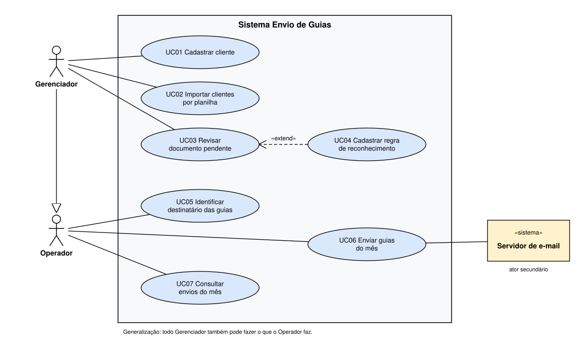

# Atividade aula 9: casos de uso do Sistema Envio de Guias

## Contexto

Trabalho em um escritório de contabilidade com cerca de 100 clientes. Todo mês o escritório envia a cada cliente as guias de imposto, de folha e de honorários (DAS, DARF, FGTS, holerites, boletos). Hoje o envio é manual e o cliente é identificado pelo nome do arquivo. Quando o nome está errado, a guia vai para o cliente errado e precisa ser reenviada.

O **Sistema Envio de Guias** lê o CNPJ dentro de cada PDF, descobre de qual cliente é a guia e envia um e-mail por cliente com todos os anexos do mês, guardando a prova de cada envio.

## Diagrama de casos de uso

Arquivo editável: [diagrama-casos-de-uso.drawio](diagrama-casos-de-uso.drawio)

| Elemento | No diagrama |
|---|---|
| Fronteira | Sistema Envio de Guias |
| Atores principais | **Gerenciador**, que cadastra clientes e resolve pendências, e **Operador**, que processa e envia as guias do mês |
| Ator secundário | **«sistema» Servidor de e-mail**, o SMTP do próprio escritório, que recebe as mensagens do sistema e as entrega aos clientes |
| Casos de uso | UC01 a UC07, todos com nome de verbo mais objeto |
| Relações extras | **«extend»**: ao revisar um documento de layout desconhecido, o gerenciador pode cadastrar uma regra para que ele seja reconhecido sozinho no mês seguinte. **Generalização**: todo gerenciador também pode fazer o que o operador faz. |

**O que fica fora da fronteira.** Gerar as guias (feito no PGDAS, Sicalc, FGTS Digital e no sistema de folha) e conferir se o valor de cada guia está certo. Isso acontece em outros sistemas, antes do Envio de Guias.

---

## Especificação do caso de uso

### UC06 Enviar guias do mês

| Campo | Conteúdo |
|---|---|
| **Ator principal** | Operador |
| **Ator secundário** | Servidor de e-mail («sistema») |
| **Descrição** | O operador confere a prévia do lote do mês e confirma. O sistema envia um e-mail por cliente com todas as guias dele em anexo e guarda a prova de cada envio. |
| **Gatilho** | As guias do mês já foram identificadas (UC05) e o operador decide enviá-las aos clientes. |
| **Pré-condição** | O operador entrou no sistema com o seu usuário. Existe ao menos uma guia identificada e ainda não enviada. O canal de e-mail do escritório está configurado. |
| **Pós-condição** | Cada envio do lote fica registrado como *Aceito*, com identificador da mensagem, hash SHA-256 de cada anexo, destinatário, data/hora e usuário, ou como *Falhou*, com o motivo. Nenhuma guia é enviada duas vezes. |

#### Fluxo principal

1. O operador pede para enviar as guias do mês.
2. O sistema monta o lote, juntando as guias identificadas de cada cliente que tem e-mail cadastrado e que recebe aquele tipo de guia.
3. O sistema confere se todo cliente que recebeu guia no mês passado tem guia neste mês.
4. O sistema mostra a prévia do lote: cliente, e-mail, anexos e, à parte, quem ficou fora e por quê.
5. O operador confirma o lote.
6. O sistema grava cada envio com a situação *Enviando*, antes de enviar.
7. O sistema entrega ao servidor de e-mail uma mensagem por cliente, com todas as guias dele em anexo.
8. O servidor de e-mail aceita a mensagem e devolve o identificador dela.
9. O sistema marca o envio como *Aceito* e guarda o identificador, o hash de cada anexo, o destinatário, a data/hora e o usuário.
10. O sistema mostra o resumo do lote: quantos aceitos, quantos falharam e quantos ficaram fora.

#### Fluxo alternativo, cliente sem guia neste mês

| | |
|---|---|
| **Quando** | No passo 3, um cliente que recebeu guia no mês passado está sem guia agora. |
| **Passos** | 1. O sistema mostra o aviso "guia faltando" para esse cliente na prévia. 2. O operador informa que o cliente não terá guia neste mês e escreve a justificativa. 3. O sistema registra a justificativa com o usuário e a data. |
| **Retorno** | O fluxo volta ao passo 4. |

#### Exceção, servidor de e-mail recusou a mensagem

| | |
|---|---|
| **Quando** | No passo 8, o servidor de e-mail recusa a mensagem ou não responde. |
| **Passos** | 1. O sistema marca o envio daquele cliente como *Falhou* e guarda o motivo devolvido. 2. O sistema segue com o próximo cliente do lote, sem parar os demais. 3. No resumo, o sistema lista os envios que falharam, para o operador corrigir e tentar de novo. |
| **Retorno** | O fluxo volta ao passo 7 com o próximo cliente. Ao tentar de novo, o fluxo volta ao passo 4 só com os envios que falharam. |

#### Regras de negócio usadas neste caso de uso

| Regra | Descrição |
|---|---|
| RN01 | Na dúvida, não envia. Guia sem cliente certo, cliente sem e-mail ou tipo de guia desligado para o cliente fica fora do lote, com o motivo registrado. |
| RN02 | Um e-mail por cliente, com todas as guias do mês em anexo. |
| RN03 | Uma guia já aceita pelo servidor só é enviada de novo com motivo informado pelo operador. |
| RN04 | O registro de cada envio (hash, destinatário, data/hora, usuário, identificador) nunca é apagado. Ele é a prova do escritório em caso de disputa. |
| RN05 | *Aceito* quer dizer que o servidor de e-mail recebeu a mensagem para enviar, não que o cliente a leu. |
